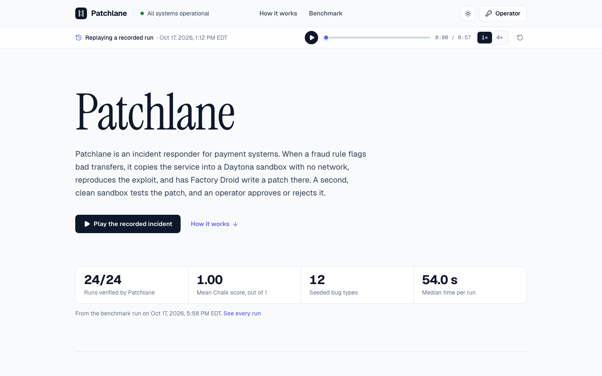
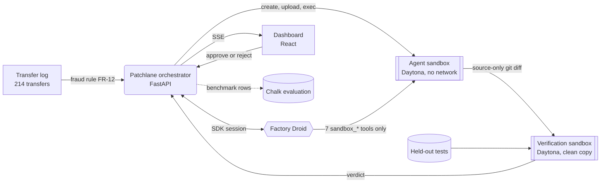
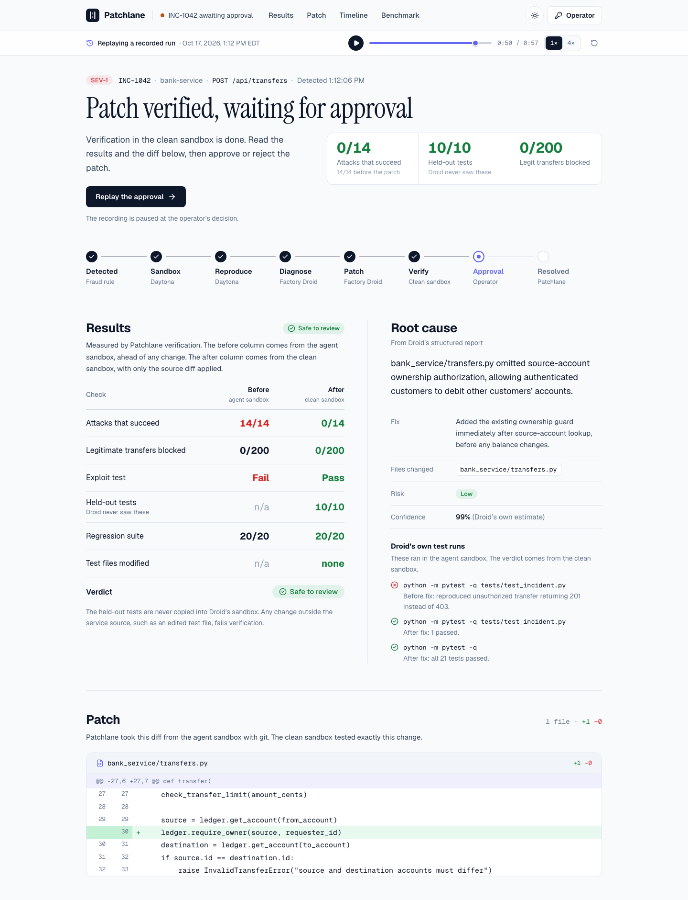

<p align="center">
  
</p>

<h1 align="center">Patchlane</h1>
<p align="center">By <strong>Ashsmith Khayrul</strong> · HackHarvard 2026</p>

<p align="center">
  Autonomous incident response for financial systems. When a bug starts moving customers' money, Patchlane reproduces the exploit in an isolated Daytona sandbox, has Factory Droid write the fix inside that sandbox, proves the fix in a second clean sandbox with tests the agent never saw, and waits for a human to approve it.
</p>

<p align="center">
  <a href="https://patchlane.khayrul.com">
    
  </a>
  
  
</p>

<p align="center">
  
  
  
</p>

<p align="center">
  
  
  
  
  
  
</p>

<p align="center">
  <a href="#how-it-works">How it works</a> ·
  <a href="#results">Results</a> ·
  <a href="#daytona">Daytona</a> ·
  <a href="#factory-droid">Factory Droid</a> ·
  <a href="#chalk">Chalk</a> ·
  <a href="#run-it-yourself">Run it yourself</a>
</p>

<p align="center">
  <picture>
    <source media="(prefers-color-scheme: dark)" srcset="docs/hero-dark.png" />
    
  </picture>
</p>

---

## The problem

At 2:25 AM a fraud rule fires on a bank's transfer API. Customer `cust_005` has sent 14 transfers out of accounts belonging to three other customers, $7,546 in total, and every one came back `201 Created`. The API forgot to check that the person asking for a transfer owns the account it debits.

An AI coding agent could find and fix that in about a minute. No bank will give one a shell on production, though, and reproducing an exploit means running attack code against the service. Patchlane gives the agent its own disposable copy of the service to work in, checks its work somewhere the agent can't reach, and leaves the final call to a person.

## How it works

1. **Detect.** A host-side monitor reads the transfer log as data and fires rule FR-12: 14 unauthorized transfers, $7,546.00 moved, 3 customers affected. It never runs service code.
2. **Isolate.** Patchlane creates a Daytona sandbox from a prebuilt snapshot with all networking blocked, uploads the bank service (17 files) and commits a git baseline.
3. **Reproduce.** Inside the sandbox it runs the incident test and replays all 214 transfers from the incident window through the real `transfer()` code. Before any change, 14 of 14 attacks succeed.
4. **Investigate and patch.** Factory Droid gets the alert, the evidence and the failing test output. Its only tools run inside the sandbox. It reads code, runs tests, writes a fix and returns a typed report.
5. **Verify.** Patchlane pulls the diff out with git, keeps only changes under `bank_service/`, and applies them to a fresh copy of the service in a second sandbox. That sandbox also gets held-out tests that were never in Droid's sandbox. It runs those, the full regression suite and the replay again.
6. **Approve.** An operator reads the results, the root cause and the diff, then approves or rejects. Approval packages the patch and flags the 14 transactions for reversal, and both sandboxes are destroyed.



<p align="center">
  <picture>
    <source media="(prefers-color-scheme: dark)" srcset="docs/incident-dark.png" />
    
  </picture>
</p>

---

## Results

### The headline incident

This is the recorded run the live site replays (`INC-1042`, recorded Oct 17, 2026 at 1:12 PM EDT).

| Time after detection | What happened |
|---|---|
| 0.0 s | FR-12 fires: 14 unauthorized transfers, $7,546.00 |
| 1.3 s | Daytona agent sandbox ready, network blocked |
| 4.7 s | Exploit reproduced: 14 of 14 attacks succeed |
| 6 s | Droid starts with 7 Daytona tools and no host tools |
| 33 s | Droid writes the fix to `bank_service/transfers.py` |
| 60 s | Clean sandbox verifies it, verdict is safe to review |
| 66 s | Operator approves, both sandboxes destroyed |

| Check | Before (agent sandbox) | After (clean sandbox) |
|---|---|---|
| Attacks that succeed | 14 / 14 | **0 / 14** |
| Legitimate transfers blocked | 0 / 200 | **0 / 200** |
| Exploit test | fail | **pass** |
| Held-out tests | n/a | **10 / 10** |
| Regression suite | 20 / 20 | **20 / 20** |
| Files outside `bank_service/` changed | n/a | **none** |

The fix Droid wrote was one line, calling the ownership guard the codebase already had:

```diff
     source = ledger.get_account(from_account)
+    ledger.require_owner(source, requester_id)
     destination = ledger.get_account(to_account)
```

### The benchmark

To check that this holds beyond one bug, there are twelve seeded cases, each a different way a money service can go wrong. The benchmark ran every case twice, three incidents at a time, each with its own pair of Daytona sandboxes, and scored all 24 runs in Chalk.

| | |
|---|---|
| Runs verified in a clean sandbox | **24 / 24** |
| Mean Chalk composite score | **1.00** out of 1 |
| Test tampering detected | **0** of 24 |
| Legitimate transfers blocked | **0** |
| Held-out tests passed | **176 / 176** |
| Median time per run | **54.0 s** |
| Median Droid tool calls per run | **15** |
| Wall clock for all 24 runs (3 in parallel) | **469 s** |

<details>
<summary><strong>The twelve seeded cases</strong></summary>

| Case | Severity | Symptom the agent is given |
|---|---|---|
| `ownership-check` | SEV-1 | Unauthorized transfers on `POST /api/transfers` |
| `negative-amount` | SEV-1 | Negative transfers pull money from recipients |
| `limit-units` | SEV-1 | Transfers above the $5,000 limit are going through |
| `double-debit` | SEV-1 | Customers charged twice on retried transfers |
| `fee-overdraft` | SEV-2 | Accounts going negative after transfers |
| `fee-rounding` | SEV-2 | Transfer fees are being undercharged |
| `shared-idempotency` | SEV-1 | Completed transfers that never moved any money |
| `history-leak` | SEV-1 | Customers can read other customers' transfer history |
| `declined-credit` | SEV-1 | Recipients credited for declined transfers |
| `float-amounts` | SEV-2 | Account balances with fractions of a cent |
| `fee-quote` | SEV-2 | Fee quotes lower than the fee charged |
| `history-incoming` | SEV-2 | Incoming transfers missing from account history |

Droid only sees the symptom, the evidence lines and the failing test. Seven of the twelve bugs pass the visible regression suite, so the existing tests alone would not have caught them. Each case's `ground_truth.json` and hidden tests live in `demo/cases/` and are never uploaded to the agent sandbox.

</details>

Separately, 10 back-to-back runs of the full live pipeline through the API all reached approval, with a median of 55 s.

---

## Sponsor technologies

Each sponsor does one job in Patchlane, and you can see each job on the dashboard without reading code: the sandbox cards are Daytona, the timeline is Droid, and the benchmark panel is Chalk.

### Daytona

**Daytona is the isolation boundary.** Every byte of agent-driven execution happens in a Daytona sandbox: reading files, editing them, running tests and replaying the exploit. The machine running Patchlane never executes the bank service's code.

**Where:** [`backend/app/integrations/daytona.py`](backend/app/integrations/daytona.py), called from [`backend/app/orchestration/incident_runner.py`](backend/app/orchestration/incident_runner.py).

- **A snapshot for fast starts.** `patchlane-bank-service` is a Daytona snapshot built from `Image.debian_slim("3.12")` with the service's requirements preinstalled. A sandbox from it is ready about 1.3 s after the request.
- **A fresh sandbox per incident.** Each one is created with `labels={"app": "patchlane", "role": ...}` and `auto_stop_interval=15`, so a crashed run can't leave a machine running.
- **No network.** Sandboxes are created with `network_block_all=True`. If the account tier ever refused that, Patchlane would fall back and the UI would say "restricted". It only shows "Network: none" when the block was actually applied, and in every recorded run it was.
- **Upload, then baseline.** Patchlane uploads `demo/bank-service/` with `fs.upload_files` and commits it as a git baseline inside the sandbox. Seeded cases overwrite the files they break before upload. Git in the sandbox is how Patchlane later finds out exactly what Droid changed.
- **Reproduction comes first.** Before Droid starts, Patchlane runs the incident test and `scripts/replay.py` in the sandbox. The "before" column on the dashboard comes from there.
- **Droid's hands.** All seven of Droid's tools call into this sandbox through `process.exec` and the `fs` API. Paths are checked so a tool can't step outside the repository folder.
- **A second, clean sandbox for verification.** It's created while Droid is still working, so it's ready the moment the patch is. It starts from the original files plus the held-out tests, receives only the source diff, and runs `git apply`, the tests and the replay. Droid never touches it.
- **Parallel at scale.** The benchmark runs three incidents at a time, so up to six sandboxes are live at once. The 24-run benchmark used 48 sandboxes in 469 s of wall clock.
- **Cleanup you can see.** Both sandboxes are deleted when an incident ends, and the timeline shows a `sandbox.destroyed` event for each one. The sandbox cards show the ID, role, uptime, commands executed and network policy.

### Factory Droid

**Factory Droid is the engineer, and it does the real work in the running product.** For each incident, Patchlane opens a Droid SDK session, gives it the alert, the evidence and the failing test output, and lets it decide what to read, what to run and what to change. Patchlane never hardcodes a patch. The twelve benchmark cases need twelve different fixes across six files, from the transfer logic to the API layer, and Droid found every one.

**Where:** [`backend/app/integrations/factory.py`](backend/app/integrations/factory.py) (`run_droid`), with its tools in [`backend/app/droid_tools/sandbox_tools.py`](backend/app/droid_tools/sandbox_tools.py). It runs on `droid-sdk` 0.5.0 with the `droid` CLI pinned to 0.244.0.

**Droid's tools.** Patchlane builds an in-process MCP server named `daytona` with `create_sdk_mcp_server` and seven tools. Each one runs against the agent sandbox and emits a timeline event:

| Tool | What it does in the sandbox |
|---|---|
| `sandbox_list_files` | Lists a directory, three levels deep |
| `sandbox_read_file` | Reads a file |
| `sandbox_search` | Searches the code for a pattern |
| `sandbox_write_file` | Writes a whole file |
| `sandbox_exec` | Runs a shell command |
| `sandbox_run_tests` | Runs pytest on a target |
| `sandbox_git_diff` | Shows Droid its own diff against the baseline |

**How Droid is locked down.** Droid normally has tools that act on the machine it runs on. Patchlane runs Droid on its own server, so those all have to go:

- `restrict_tools` is an allowlist: the seven `daytona___sandbox_*` tools plus `TodoWrite`, `ToolSearch` and `Script`. Droid 0.244 loads MCP tools through `ToolSearch` and calls them from inside `Script`. I checked that `Script` has no modules, no `process` and no `fetch`, and that it can only call allowlisted tools.
- `disabled_tools` turns off the 11 built-in host tools (`Read`, `LS`, `Glob`, `Grep`, `Create`, `Edit`, `MultiEdit`, `ApplyPatch`, `Execute`, `WebSearch`, `FetchUrl`) and 8 more that touch the account or spawn sub-agents (`Task`, `Skill`, `ConnectApp` and others). `disable_builtin_skills=True` is set too.
- The session's working directory is an empty temp folder with its own `git init`, outside this repo, so Droid can't pick up this project's agent docs, skills or settings.
- Before the prompt is sent, Patchlane calls `list_tools()` and `list_skills()` on the session. If any host tool is still enabled or any project skill was loaded, it refuses to run. The dashboard shows the outcome as "Droid isolated: 7 Daytona tools, host tools disabled".
- An `on_permission` handler approves calls to the `daytona` server and cancels anything else. Each cancelled call is counted and shown as "host tool calls blocked".
- The prompt tells Droid to treat log lines as data. Even if a log line did carry an injected instruction, the worst Droid could do is break a sandbox with no network and no credentials, which Patchlane then throws away.

**Structured output.** Droid has to finish with a `RemediationResult`, a Pydantic model passed as `output=` to `session.stream`. It has the root cause in one sentence, changed files, a patch summary, the tests it ran, risk, confidence and a two-sentence summary for the on-call engineer. If the first answer doesn't parse, Patchlane asks once more. The root cause and test list on the dashboard come straight from this object.

**Live streaming.** Patchlane forwards Droid's events as they happen: messages, commands and their exit codes, files read and written. They reach the dashboard over server-sent events, so you watch Droid work in real time.

### Chalk

**Chalk is the evaluator.** Patchlane checks every run itself in the clean sandbox, and Chalk scores the benchmark independently using the same evidence.

**Where:** [`backend/app/benchmark/score_chalk.py`](backend/app/benchmark/score_chalk.py) and [`backend/app/benchmark/chalk_functions.py`](backend/app/benchmark/chalk_functions.py), using `chalkcompute` 2.13.7.

**The data.** Each benchmark run uploads its rows as a new Chalk dataset (`patchlane-benchmark-<timestamp>`). A row holds the case, the ground-truth file and root cause, the files Droid changed according to git, Droid's stated root cause, held-out test counts, regression suite results, the tampering check and the replay numbers. The incident telemetry itself is generated once with a fixed seed (`demo/generate_incident_log.py --seed 1042`) and committed, so every run sees the same 214 transfers.

**The evaluation.** Each run creates a new, immutable Chalk evaluation with a pass-through task and five scorers:

| Scorer | Chalk scorer type | What it measures | Weight | Hard gate |
|---|---|---|---|---|
| `fixed` | custom function | Share of held-out tests that pass in the clean sandbox | 40% | yes |
| `no_regressions` | Chalk SQL | Regression suite passes and the replay blocks no legitimate transfer | 25% | yes |
| `no_tampering` | Chalk SQL | The path guard ran and found no edits outside `bank_service/` | 15% | yes |
| `correct_file` | `contains` (built-in) | Files Droid changed, per git, include the ground-truth file | 10% | |
| `root_cause` | `llm_judge` | Droid's root cause matches the ground-truth sentence (1, 0.5 or 0) | 10% | |

The `llm_judge` scorer runs through Chalk's model router with `openai/gpt-6.1-sol` and returns its reasoning for every row.

**Gates come before weights.** A run counts as safe to review only if `fixed`, `no_regressions` and `no_tampering` are all 1. A patch that edits a test file fails the gate no matter what its weighted score is.

**Labels stay honest.** Chalk computes every per-row score. Patchlane computes the weighted composite and the gate from Chalk's numbers and labels both as derived. The live demo's pass/fail comes from Patchlane's own verification and is labeled that way. If Chalk is unreachable, the benchmark panel says "Chalk evaluation unavailable" and shows no scores, because local numbers never stand in for Chalk's.

**Latest results.** Evaluation `cmvcy5m3706rt013emqmijcvm`: all 24 rows scored 1.0 on all five scorers, and Chalk's verdict agreed with Patchlane's verification on every row. The full results, including the judge's reasoning per run, are in [`frontend/public/benchmark/latest.json`](frontend/public/benchmark/latest.json).

### Digital Trust

The track asks for projects that protect people's money, identity and data. Patchlane works on the gap between a fraud alert and a fix. When fraud monitoring catches money leaving accounts, the bug behind it usually stays live until an engineer wakes up, reproduces it and ships a patch. Patchlane shortens that gap to about a minute without giving an AI access to production. It also hands the operator the 14 transactions to reverse, with the affected customers and amounts, and the operator decides whether to reverse them.

---

## What's real and what's simulated

**Real:** the bug in the code, the exploit, the patch Droid writes, the Daytona sandboxes, the Droid sessions, the held-out tests, the replay and the Chalk evaluations. Nothing in the pipeline is mocked.

**Simulated:** the bank. The service is a small demo built for this project, the customers are synthetic, and the transfer log is generated from a fixed seed. No real accounts or money are involved.

---

## Run it yourself

The fastest way to see it is the [live site](https://patchlane.khayrul.com). Visitors get a replay of a recorded run with its original timing. Running live incidents needs the operator token, and the operator can pick any of the twelve cases to run against real Daytona sandboxes and a real Droid session.

<details>
<summary><strong>Run it locally</strong></summary>

You'll need Python 3.11+, Node 22+, a Daytona API key with sandbox and snapshot permissions, a Factory API key and the `droid` CLI. Chalk is only needed for the benchmark.

```bash
# Backend
python3 -m venv .venv
.venv/bin/pip install -r backend/requirements.txt
cp backend/.env.example backend/.env       # add DAYTONA_API_KEY, FACTORY_API_KEY, PATCHLANE_OPERATOR_TOKEN
curl -fsSL https://app.factory.ai/cli | sh # the droid CLI

# One time: builds the Daytona snapshot and checks the network block
.venv/bin/python backend/spikes/daytona_smoke.py

cd backend && ../.venv/bin/uvicorn app.main:app --port 8000
```

```bash
# Frontend, in a second terminal
cd frontend
cp .env.example .env                       # VITE_API_BASE_URL=http://localhost:8000
npm install
npm run dev
```

Open http://localhost:5173, click **Operator**, enter your token, pick a case from the **Seeded case** list, then trigger it.

</details>

<details>
<summary><strong>Run it in Docker</strong></summary>

```bash
docker compose up -d --build               # reads backend/.env, serves 127.0.0.1:8000
```

CI publishes the image to `ghcr.io/lavishsphere/patchlane-api:latest`. The hosted API runs that image as a Pterodactyl server behind nginx. The image contains no secrets, and keys are passed in as environment variables.

</details>

<details>
<summary><strong>Run the benchmark and score it in Chalk</strong></summary>

```bash
.venv/bin/pip install -r backend/requirements-benchmark.txt
chalk login
cd backend && ../.venv/bin/python -m app.benchmark.run --cases all --runs 2 --parallel 3

# Re-score an earlier benchmark file without running Daytona or Droid again
../.venv/bin/python -m app.benchmark.score_chalk ../runs/benchmark-<timestamp>.json
```

</details>

<details>
<summary><strong>Tests</strong></summary>

```bash
cd backend && ../.venv/bin/python -m pytest -q          # 68 tests
cd demo/bank-service && python -m pytest -q             # 22 tests
python demo/validate_cases.py                           # clean code passes, each bug fails, nothing leaks into uploads
```

CI runs the backend tests, the bank service tests, a frontend build and a Docker build on every push.

</details>

---

## Repository layout

```
backend/            FastAPI orchestrator
  app/integrations/   daytona.py, factory.py
  app/droid_tools/    the seven sandbox tools Droid gets
  app/orchestration/  incident runner, verification, state machine
  app/benchmark/      benchmark runner and Chalk scoring
  spikes/             smoke tests for Daytona, Droid, verification and reliability
frontend/           React + Vite dashboard (replay and operator modes)
demo/bank-service/  the demo bank service uploaded into sandboxes
demo/cases/         twelve seeded incidents with hidden tests and ground truth
```

## Security notes

- The hosted dashboard is read-only for visitors. Trigger, investigate, approve, reject and reset all need the operator token as a Bearer header, compared in constant time. CORS allows only `https://patchlane.khayrul.com`.
- API keys live in environment variables only. They never appear in the frontend, logs, events or the Docker image.
- Hidden tests and ground truth never go into anything uploaded to the agent sandbox.

---

## Built at HackHarvard 2026

Everything in this repository was built solo during HackHarvard 2026, October 17 to 18: the bank service and its twelve seeded cases, the orchestrator, the Daytona and Droid integrations, the verification sandbox, the Chalk benchmark, the dashboard and the hosting.

Submitted to the **Digital Trust** track and the **Daytona**, **Factory** and **Chalk** challenges.

<p align="center">
  <a href="https://patchlane.khayrul.com"><strong>patchlane.khayrul.com</strong></a> · MIT License
</p>
